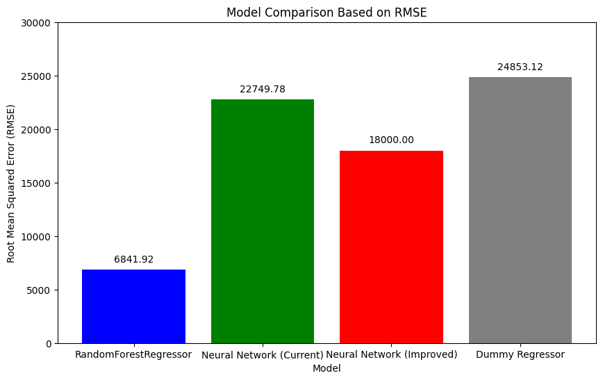

# Car Price Prediction 🚘🚗💸💵

Predicting the price of used cars based on basic parameters (brand, model, engine size, fuel type, kilometers driven, previous owners, etc.).

I did this project with three different approaches:

1. RandomForestRegressor
2. DummyRegressor
3. A small neural network

[](https://colab.research.google.com/drive/1NRkQoXENJTx3TqrdhVQFmgVReBohDtha?usp=sharing)

## Contents

1. [Dataset](#dataset)
2. [Preprocessing](#preprocessing)
3. [Models](#models)
4. [Results](#results)
5. [How to run](#how-to-run)
6. [Limitations and ideas](#limitations-and-ideas)
7. [Credits](#credits)

## Dataset

- File: `car_price.csv` (used car listings, prices originally in Indian rupees)
- Source: Kaggle. Sadly I can't link the dataset. It came with a pretty good tutorial too.
- Original size: 5,512 rows × 10 columns
- After dropping the rows with missing values it was reduced to 5,389 rows
- Columns: `car_name`, `car_prices_in_rupee`, `kms_driven`, `fuel_type`, `transmission`, `ownership`, `manufacture`, `engine`, `Seats`

This repo doesn't include the dataset, because I have no information about whether it can be shared.

## Preprocessing

Every step of processing the data for training and testing is included in the notebook:

- Dropped the `Unnamed: 0` column
- Split `car_name` into two columns: `manufacturer` and `model`
- Cleaned text-formatted numbers: removed `kms` from `kms_driven`, `cc` from `engine`, `Seats` from `Seats`, and kept only the digit from `ownership` (1st owner → 1, ...)
- Converted prices from `Lakh` / `Crore` text (×100,000 / ×10,000,000) into numbers, then to US dollars at a fixed rate of 0.012 USD per rupee
- Label-encoded `manufacturer`, `model`, `fuel_type` and `transmission`
- Dropped rows with missing values

**Features (9):** manufacturer, model, year of manufacture, kilometers driven, engine size, fuel type, transmission, seats, ownership.

**Target:** price in USD

**Split:** 80 % train / 20 % test (`random_state=42`) → 4,311 training and 1,078 test samples.

## Models

| Model | Configuration |
| --- | --- |
| `DummyRegressor` | `strategy="median"` |
| `RandomForestRegressor` | `n_estimators=1500`, `max_depth=50`, `random_state=42` |
| Neural network (Keras `Sequential`) | `Dense(64, relu)` → `Dense(32, relu)` → `Dense(1)`;<br>2,753 parameters; Adam optimizer, MSE loss, 25 epochs, batch size 1 |

## Results

Evaluated on the held-out test set (prices in USD):

| Model | RMSE | MAE | R² |
|---|---|---|---|
| DummyRegressor (median) | 24,853 | 9,807 | -0.095 |
| RandomForestRegressor | **6,842** | **2,556** | **0.917** |
| Neural network | 22,750 | - | - |

- The Random Forest clearly beats the baseline and explains about 92 % of the variance in test prices.
- Its R² on the training set is 0.981, so it fits the training data noticeably better than unseen data (some overfitting).
- The neural network is only slightly better than the median baseline in this setup (see ideas below).



## How to run

The notebook was written for Google Colab and reads the data from Google Drive.

**In Colab:** click the badge above and run all cells. To run it you need the data. Since I can't provide the original, you can look it up on Kaggle, where you may find the original or a similar dataset. Upload `car_price.csv` to your Colab session (or to your Google Drive) and change the path in the data-loading cell, for example:

```python
data = pd.read_csv("/content/car_price.csv")
```

Note that the preprocessing expects the original column names and text formats (for example `10.03 Lakh` and `86,226 kms`), so a different dataset will need some changes.

## Limitations and ideas

- **Neural network inputs are not scaled.** Price and mileage values are very large compared with the encoded categories, which makes training hard. Standardizing the values (e.g. `StandardScaler`) should help a lot.
- **Label encoding.** `fuel_type` and `transmission` have few categories, so one-hot encoding would fit them better. `manufacturer` and `model` have many categories (32 and 230), where one-hot would add hundreds of columns; target encoding is practical there (it must be fitted on the training set only, otherwise information leaks from the test set). Label encoding is also acceptable and works well with tree-based models like Random Forest, but it is less suitable for my neural network.
- **Metric.** The neural network is compiled with `AUC`, which is a classification metric and always shows 0 for regression. `mae` would be more meaningful.
- **Batch size 1** makes training slow; a larger batch (e.g. 32) is much faster.
- **Model name** keeps only the second word of the car name, so variants (engine, trim) are lost.
- **Fixed exchange rate** (0.012) is a simplification.
- Hyperparameter tuning (`GridSearchCV`) and cross-validation could be added for a more reliable comparison.

## Credits

- Dataset: sadly I can't share it with you, but it is from Kaggle.
- Some parts of the code are adapted from public examples and from a course I took.
- I also used the help of LLMs to visualize and present my project.

## License

MIT (see `LICENSE`)
